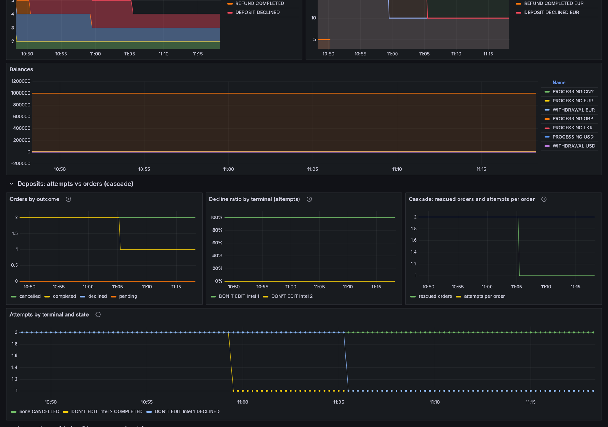
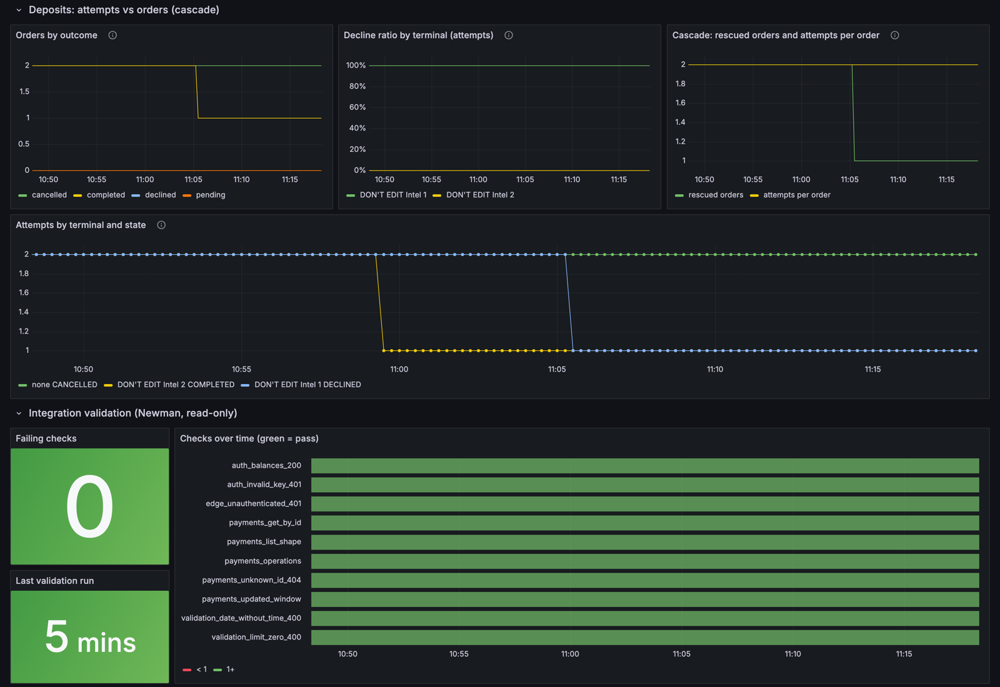

# Payment gateway sandbox monitoring

Black-box monitoring for a payment gateway API sandbox: a small exporter, Prometheus and Grafana, started on any host with one script.

The sandbox does not expose Prometheus metrics of its own, so the exporter looks at it from the outside, the way a merchant would. Every minute it makes a few read-only API calls. It never creates, refunds or cancels payments.

## What it covers

The project is a working slice of an automated integration-monitoring setup for a payment gateway. How it maps to the usual requirements:

| Requirement | Status | How |
| --- | --- | --- |
| Monitoring health | Done | `gateway_api_up`, latency and last status code per endpoint, exporter freshness |
| Detecting broken integrations | Partly | Key rejected (expired, IP not whitelisted), payments stuck in CHECKOUT, lost orders after the cascade, a terminal that declines most attempts, orders without `referenceId`, all labelled by shop. Per-merchant baselines need platform-side data |
| Integration validation / testing | Done | A read-only Postman collection (10 GET checks of the API contract) runs in Newman every 5 minutes; pass/fail per check is exported as metrics and alerted on |
| Callback handling | Not yet | Planned: a webhook receiver that checks the HMAC signature and counts received, invalid and duplicate callbacks. It needs a public URL (tunnel) to receive sandbox webhooks |
| Monitoring and alerts | Done | Eight Prometheus alert rules; routing to Slack or PagerDuty through Alertmanager is the next step |

Things this setup already caught on the sandbox: a 40-minute outage (Cloudflare 502), the default Python User-Agent blocked by Cloudflare (403, error 1010), an API key that started failing after an IP whitelist was added, a withdrawal that never left CHECKOUT, and a first-route terminal that declines every attempt while the cascade quietly completes the orders on the second one.

## Dashboard

The Grafana dashboard after 30 minutes against the sandbox. The top shows whether the API is up and our key works, then latency, status codes, payments and balances:



Below it, deposits are split into attempts and orders. Here every order is completed, but only after a declined attempt on the first terminal, whose decline ratio stays at 100%. The last row shows the Newman checks, all passing:



## Run it

You need podman or docker, curl, a sandbox API key, and the sandbox base URL.

```bash
git clone https://github.com/yaskazeko/paytech-sandbox-monitoring.git
cd paytech-sandbox-monitoring
GW_BASE_URL=https://sandbox.example.com ./run.sh up
```

The script asks for the API key (input hidden). To skip the prompt, export it first:

```bash
read -rsp "API key: " GW_KEY && export GW_KEY GW_BASE_URL=https://sandbox.example.com && ./run.sh up
```

Then open:

| What | URL |
| --- | --- |
| Grafana dashboard (view without login; `admin` / `admin` to edit) | http://localhost:3000 |
| Prometheus, alerts on the Alerts tab | http://localhost:9090 |
| Raw exporter metrics | http://localhost:9105/metrics |
| Validation results (Newman) | http://localhost:9106/metrics |

The first data shows up after about a minute.

Other commands:

```bash
./run.sh status                 # containers and exporter health
./run.sh logs exporter          # or validator, prometheus, grafana
./run.sh down                   # stop; data volumes are kept
./run.sh purge                  # stop and delete data volumes
```

On macOS and Windows, podman needs its VM running: `podman machine start`.

## API key handling

- The key is read from `GW_KEY`, or typed at the prompt, and passed to the exporter container as an environment variable. It is never written to a file in this repository.
- Anyone who can run `podman inspect` / `docker inspect` on the host can read container environment variables. Run this on a machine you control.
- If the key has an IP whitelist, add the public IP of the host running the exporter. Otherwise `gateway_api_auth_ok` stays at 0 and the API answers 401.

## Metrics

| Metric | Meaning |
| --- | --- |
| `gateway_api_up` | 1 if an unauthenticated call gets 401, so the edge and origin are reachable. 5xx or a Cloudflare block gives 0 |
| `gateway_api_auth_ok` | 1 if a call with our key succeeds. Catches expired keys and IP-whitelist problems |
| `gateway_api_request_seconds{endpoint}` | Latency of the last call per endpoint |
| `gateway_api_last_status_code{endpoint}` | HTTP status of the last call (0 = network error) |
| `gateway_payments{shop,type,state,currency}` | Payments updated in the last 24 hours |
| `gateway_payments_amount{shop,type,state,currency}` | Sum of their amounts |
| `gateway_payments_stuck_checkout{shop,type}` | Payments still in CHECKOUT 30+ minutes after creation |
| `gateway_deposit_attempts{shop,terminal,state}` | Every deposit row, including declined cascade attempts |
| `gateway_terminal_decline_ratio{terminal}` | DECLINED / (COMPLETED + DECLINED) attempts per terminal |
| `gateway_deposit_orders{shop,outcome}` | Orders by final outcome: completed, declined (lost), cancelled, pending |
| `gateway_deposit_order_success_ratio{shop}` | Completed / (completed + declined) orders, after the cascade |
| `gateway_deposit_orders_rescued{shop}` | Completed orders that had at least one declined attempt |
| `gateway_deposit_attempts_per_order` | Average attempts per finished order (1 = no cascade needed) |
| `gateway_deposit_orders_without_reference{shop}` | Orders whose root payment has no `referenceId` |
| `gateway_balance{currency,kind}` | PROCESSING and WITHDRAWAL balances |
| `gateway_exporter_last_refresh_timestamp_seconds` | When the exporter last refreshed |

### Attempts and orders (cascade)

With cascading, a declined first attempt is normal: the gateway routes the payment to the next terminal. In the API each declined attempt is a separate DEPOSIT with `parentPaymentId` pointing to the order's root payment and no `referenceId`; the root's state is what the customer sees. On the sandbox, attempts on `Intel 1` are declined with error 3.00 ("Declined by Acquirer") and the root then completes on `Intel 2`.

So the exporter counts deposits twice. **Attempts** show how each terminal behaves; **orders** (root plus its attempts) show whether the money came in. A per-payment decline ratio mixes the two and would report 50% failures for a day on which every order was paid.

## Integration validation

`validation/gateway-readonly.postman_collection.json` holds 10 GET-only checks, safe to run on a schedule:

| Check | Expects |
| --- | --- |
| `edge_unauthenticated_401` | 401 without a key, not 5xx or a Cloudflare block |
| `auth_invalid_key_401` | 401 with a wrong key |
| `auth_balances_200` | 200 with our key; balances carry currency, type, amount |
| `payments_list_shape` | 200; `result` is an array and `hasMore` a boolean |
| `payments_get_by_id` | 200 for a payment from the list; id, state, type, amount, currency present |
| `payments_operations` | 200; non-empty list of operation and paymentState |
| `payments_unknown_id_404` | 404 for an id that does not exist |
| `payments_updated_window` | 200 for an `updated.gte` window query |
| `validation_date_without_time_400` | 400 for a bare date in `updated.gte` |
| `validation_limit_zero_400` | 400 for `limit=0` |

Every request is also checked to answer within 5 seconds. `validation/runner.js` runs the collection through Newman's Node API inside the official `postman/newman` image and serves on `:9106/metrics`:

| Metric | Meaning |
| --- | --- |
| `gateway_validation_check_ok{check}` | 1 if every assertion of the check passed in the last run |
| `gateway_validation_check_response_seconds{check}` | Response time of the check |
| `gateway_validation_assertions{result}` | Passed and failed assertions in the last run |
| `gateway_validation_up` | 0 if Newman itself errored |
| `gateway_validation_last_run_timestamp_seconds`, `gateway_validation_run_duration_seconds` | When and how long the last run took |
| `gateway_validation_runs_total`, `gateway_validation_failed_runs_total` | Run counters |

The same collection can be opened in Postman or run by hand: `newman run validation/gateway-readonly.postman_collection.json --env-var base_url=https://sandbox.example.com --env-var api_key=…` (the key then shows in your shell history; prefer the container).

## Alerts

Defined in `prometheus/rules.yml`, visible in the Prometheus UI (no Alertmanager is included):

- `GatewayApiDown` — the API does not answer 401 to an unauthenticated call for 3 minutes
- `GatewayAuthFailing` — the API is up but our key is rejected for 5 minutes
- `GatewayExporterDown` — no fresh data for 5 minutes
- `GatewayPaymentsStuckInCheckout` — payments stuck in CHECKOUT for 30 minutes
- `GatewayDepositOrdersLost` — more than half of a shop's deposit orders end declined after all cascade attempts (at least 3 finished orders), for 15 minutes
- `GatewayTerminalDeclining` (info) — a terminal declines over 80% of its attempts for 30 minutes; orders still complete, but each one pays an extra attempt
- `GatewayValidationCheckFailing` — a validation check failed in two consecutive runs
- `GatewayValidationStale` — the validation runner is down, erroring, or silent for 15 minutes

## Settings

Environment variables read by `run.sh`:

| Variable | Default |
| --- | --- |
| `GW_BASE_URL` | required — the sandbox base URL, e.g. `https://sandbox.example.com` |
| `BIND` | `127.0.0.1` (set `0.0.0.0` to open the ports to the network) |
| `PROM_PORT`, `GRAFANA_PORT`, `EXPORTER_PORT`, `VALIDATOR_PORT` | `9090`, `3000`, `9105`, `9106` |
| `VALIDATION_INTERVAL_SECONDS` | `300` — how often the validation collection runs |
| `RUNTIME` | podman if installed, otherwise docker |
| `GW_KEEPASS_ENTRY` | unset; with a `with-secrets` helper on PATH, the key is fetched from that KeePass entry |
| `GW_REFRESH_SECONDS` | `60` — how often the exporter calls the API |
| `GW_WINDOW_HOURS` | `24` — payments window |
| `GW_STUCK_MINUTES` | `30` — age after which a CHECKOUT payment counts as stuck |

## Layout

```
run.sh                     start / stop / status / logs
exporter/                  stdlib-only Python exporter and its Dockerfile
validation/                read-only Postman collection and the Newman runner
prometheus/                scrape config and alert rules
grafana/provisioning/      datasource and dashboard provider
grafana/dashboards/        the dashboard JSON
```
